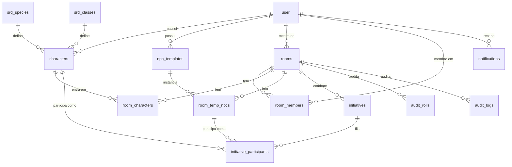

# Modelo de dados

> A **referência legível** do modelo de dados: descreve tabelas, colunas e relações em
> linguagem de domínio. A **fonte da verdade executável** é o schema Prisma em
> [`prisma/schema/`](../../prisma/schema/) (modular, um `*.prisma` por domínio); aqui
> explicamos o *porquê* e as regras que o schema sozinho não conta (invariantes, CHECK
> constraints, decisões de modelagem).

## Convenções (padrão FH)

- PK `id` do tipo **UUID** (`gen_random_uuid()` no banco).
- Colunas em **snake_case** via `@map`; tabela via `@@map` (plural).
- Datas em **`Timestamptz`**; `updated_at` é `@updatedAt` do Prisma (client-side — inserts
  crus em SQL precisam fornecer a coluna).
- Um domínio por arquivo em `prisma/schema/`; um único `generator` + `datasource` em `schema.prisma`.
- **Exceção auth (P2):** os models do Better Auth são **minúsculos** (`user`, `Session`,
  `Account`, `Verification`) porque o adapter da lib resolve os nomes assim; as PKs seguem
  UUID com `advanced.database.generateId: "uuid"` no `auth.ts` (a lib gera o id).

## Domínios

### Auth (P2 — Better Auth)

| Tabela | Propósito | Observações |
|---|---|---|
| `users` | conta da pessoa | `email` único e sempre lowercase; `email_verified` **não** é só decorativo: criar sala exige verificação (regra aplicada na P7/P12); `deleted_at` nullable = soft delete (fluxo em P12, a lib não conhece a coluna) |
| `sessions` | sessão ativa | `token` único; cookie httpOnly `better-auth.session_token` carrega o token; `expires_at` controla validade; cascade no delete do user |
| `accounts` | credenciais por provider | 1 linha por provider (`credential` para e-mail/senha com `password` hasheado; `discord` para OAuth); cascade no delete do user |
| `verifications` | tokens de verificação/reset | `identifier` = e-mail; `expires_at` define a validade do link |

**Invariantes:** exclusão de user cascata sessões e accounts (uma conta apagada encerra
tudo imediatamente); soft delete de conta (P12) **não** usa cascade — o user é
marcado em `deleted_at`, não apagado, preservando auditoria por 7 dias.

### SRD 5.2 (P3; populado pelo seeder em P4)

Nove tabelas de referência **somente leitura por construção**: nenhum service escreve
nelas — só o seeder. Cada uma guarda os campos que a UI consulta/filtra soltos
(`slug` único, `name`, e o que cada lista precisa) e o objeto completo do SRD em
`payload` (Json) — o seeder não normaliza o SRD inteiro, normaliza o que o produto usa.

| Tabela | Campos soltos | Nota |
|---|---|---|
| `srd_species` | — | traits/velocidade/tamanho no payload |
| `srd_classes` | `hit_die` | alimenta o cálculo de HP do wizard |
| `srd_subclasses` | `level_gained`, FK classe | filtradas por classe no wizard |
| `srd_class_features` | `level`, FK classe + subclass opcional | features por nível |
| `srd_backgrounds` | — | |
| `srd_feats` | — | feat Alert alimenta bônus de iniciativa |
| `srd_spells` | `level`, `school` (indexados) | filtro de wizard por nível |
| `srd_equipment` | `category` | |
| `srd_monsters` | `challenge_rating` (Float), `type` | fonte para NPC templates |

### Personagens (P3; usado por P5/P6)

| Tabela | Propósito | Observações |
|---|---|---|
| `characters` | ficha de PJ **e** NPC completo | cálculos congelados em colunas (`hp_max`/`hp_current`, `armor_class`, `initiative_mod`, `proficiency_bonus`) — o wizard calcula no create/edit; listas de skills/spells/equipment/feats ficam em Json; `is_npc` marca NPC completo; `is_visible_to_master` é o toggle de privacidade; FKs de SRD são `SetNull` (referência some, ficha sobrevive) |
| `npc_templates` | modelo leve de NPC reutilizável | stat block resumido (`hp_max`, `armor_class`, `initiative_mod`) + `statblock` Json (ações, reações, resistências…); `is_public` expõe a outros mestres |

**Invariantes:** dono único (`owner_user_id`, cascade); a privacidade é dada de ficha, não
de sala — o service do mestre filtra leitura por `is_visible_to_master`.

### Salas (P3; usado por P7)

| Tabela | Propósito | Observações |
|---|---|---|
| `rooms` | uma mesa de jogo | `code` 6 chars **único** (gerado com retry no service); `status`: `lobby → active → finished`, `destroyed` é terminal (P12); `turn_seconds` default 120 (P10); `is_paused` liga/desliga o timer; `custom_sound_url` (P11); `master_user_id` é **nullable com SetNull** — é o caminho para a sala órfã de P12 (service marca `destroyed` antes de liberar a exclusão da conta) |
| `room_members` | membership | **PK composta (room_id, user_id)** = membro único; papel fixo no ingresso (`master` = quem criou; resto `player`) |
| `room_characters` | quem está na sala e qual PJ é ativo | PK composta (room_id, character_id); `active_for_user_id` preenchido só para PJ; **UNIQUE (room_id, active_for_user_id)** — NULLs múltiplos passam (NPCs), mas 2º PJ ativo do mesmo jogador não; o upsert do service troca o PJ usando essa UNIQUE como alvo |
| `room_temp_npcs` | instância de NPC temporário | copia stats do template no momento da criação (`label` "Goblin #3", `instance_number` incremental); editar o template depois não altera instâncias vivas |

**Invariantes:** 1 PJ ativo por jogador por sala (UNIQUE acima); sala `destroyed` não
aparece em listas nem aceita join (regra do service).

### Iniciativa (P3; usado por P8–P10)

| Tabela | Propósito | Observações |
|---|---|---|
| `initiatives` | um combate da sala | state machine `draft → rolling → ordered → active → finished` (transições autoritativas no server, regra em `docs/negocio/` na P8); `current_position` aponta o turno; `turn_started_at` baseia o countdown (P10); `paused_at` congela (retomada reajusta `turn_started_at` preservando o restante); histórico: várias iniciativas por sala, no máximo uma não-finalizada (guardado pelo service, não por UNIQUE) |
| `initiative_participants` | participante do combate | **CHECK XOR: `character_id` ou `temp_npc_id`, exatamente um** (constraint escrita à mão na migration — Prisma não tem CHECK); `label` congela o nome de exibição; `user_id_responsible` diz quem rola/passa (NULL para NPC — rola o mestre); `initiative_mod` congela o modificador na rolagem e `roll_result` guarda o **total** (d20+mod) — o desempate oficial precisa dos dois; `position` é a ordem; `added_mode`: `roll` (disparo inicial) ou `append` (adicionado no meio) |

**Invariantes:** XOR acima (validado por teste de integração que tenta insert inválido);
`has_rolled`/`has_played` controlam o fluxo da state machine.

### Plataforma (P3; usado por P8/P12)

| Tabela | Propósito | Observações |
|---|---|---|
| `notifications` | aviso persistido por usuário | tipo (`your_turn`, `you_are_next`, `timer_warning`, `room_destroyed`, `member_joined`) + `payload`; índice `(user_id, created_at)` |
| `audit_rolls` | toda rolagem autoritativa | resultado bruto, modificador e total; **índice (room_id, created_at)** para a timeline de auditoria |
| `audit_logs` | evento de domínio auditável | `action` + `entity_id` + payload; user_id é `SetNull` — **auditoria sobrevive à exclusão do usuário** |

## Política de delete

| Alvo | Comportamento | Motivo |
|---|---|---|
| user apagado de verdade | sessões/accounts/fichas/templates/memberships/notificações caem (Cascade) | nada órfão de conta inexistente |
| user apagado | salas ficam (`master_user_id` → NULL), auditoria fica (`user_id` → NULL), participante fica (`user_id_responsible` → NULL) | P12 marca salas `destroyed` e preserva o histórico |
| room apagada | membros/PJs/temp NPCs/iniciativas/notificações/auditoria da sala caem (Cascade) | a sala é a raiz do combate |
| character apagado | participante de iniciativa cai junto (Cascade) | participante sem ficha perde o sentido; XOR segue íntegro |
| srd referenciado some | fichas ficam, FKs viram NULL (SetNull) | ficha congela stats, não depende do SRD vivo |

## Diagrama (visão geral)

