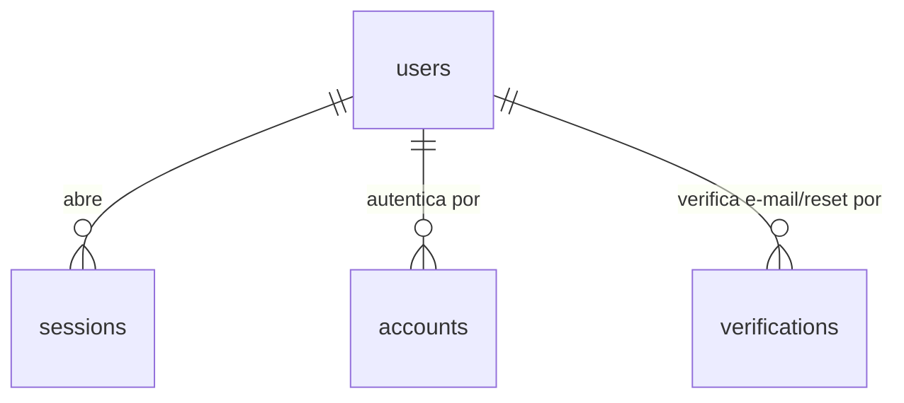

# Modelo de dados

> A **referência legível** do modelo de dados: descreve tabelas, colunas e relações em
> linguagem de domínio. A **fonte da verdade executável** é o schema Prisma em
> [`prisma/schema/`](../../prisma/schema/) (modular, um `*.prisma` por domínio); aqui
> explicamos o *porquê* e as regras que o schema sozinho não conta (invariantes, CHECK
> constraints, decisões de modelagem).

## Convenções (padrão FH)

- PK `id` do tipo **UUID**.
- Colunas em **snake_case** via `@map`; tabela via `@@map`.
- Datas em **`Timestamptz`**.
- Um domínio por arquivo em `prisma/schema/`; um único `generator` + `datasource` em `schema.prisma`.
- **Exceção auth (P2):** os models do Better Auth são **minúsculos** (`user`, `Session`,
  `Account`, `Verification`) porque o adapter da lib resolve os nomes assim; as PKs seguem
  UUID com `advanced.database.generateId: "uuid"` no `auth.ts` (a lib gera o id).

## Domínios

### Auth (P2 — Better Auth)

| Tabela | Propósito | Observações |
|---|---|---|
| `users` | conta da pessoa | `email` único e sempre lowercase; `email_verified` **não** é só decorativo: criar sala exige verificação (regra aplicada na P7/P12) |
| `sessions` | sessão ativa | `token` único; cookie httpOnly `better-auth.session_token` carrega o token; `expires_at` controla validade; cascade no delete do user |
| `accounts` | credenciais por provider | 1 linha por provider (`credential` para e-mail/senha com `password` hasheado; `discord` para OAuth); cascade no delete do user |
| `verifications` | tokens de verificação/reset | `identifier` = e-mail; `expires_at` define a validade do link |

**Invariantes:** exclusão de user cascata sessões e accounts (uma conta apagada encerra
tudo imediatamente); soft delete de conta (P12) **não** usa essas tabelas — o user é
marcado, não apagado, preservando auditoria por 7 dias.

### Domínios por vir

- **SRD 5.2** (P3/P4): 9 tabelas de referência somente leitura.
- **Personagens** (P3/P5): `characters`, `npc_templates`.
- **Salas** (P3/P6): `rooms`, `room_members`, `room_characters`, `room_temp_npcs`.
- **Iniciativa** (P3/P7): `initiatives`, `initiative_participants` (CHECK XOR
  character/temp_npc).
- **Plataforma** (P3): `notifications`, `audit_rolls`, `audit_logs`.

## Diagrama (parcial — auth)

